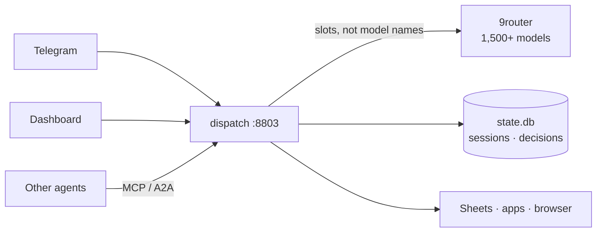

<div align="center">


<a href="https://github.com/naelrudd"></a>

<br/>

<a href="https://x.com/naelrudd"></a>
<a href="https://www.linkedin.com/in/natanaelrudy/"></a>
<a href="https://medium.com/@natanaelrudyhadinata"></a>
<a href="https://natanaelrudy.gumroad.com"></a>

<br/>


</div>

```text
$ dispatch --prompt "who is naelrudd?"
  placement  → portfolio / naelrudd          (matched: agent-stack, llms, malang)
  slot       → deep
  model      → the one that actually ships
  decision   → logged below, with reasons. welcome in.
```

I don't rent my AI stack, I run it. Every prompt I send — from Telegram, my dashboard, or another agent — goes through one dispatch service on my own VPS that picks the session, picks the model, runs the tools, and writes the whole thing into a database I own. Most of what's below exists because building that made me need it.

📍 Malang, Indonesia · 🎓 Universitas Negeri Malang · 🟢 Open to freelance: automation/agent builds + data & spreadsheet work

---

## 🧭 Route yourself

Like any good dispatch, this profile sends you where you actually wanted to go:

| You are… | Your prompt sounds like… | Go to |
|---|---|---|
| A recruiter | *"can he build agent systems?"* | [Decision log ↓](#-decision-log) + [LinkedIn](https://www.linkedin.com/in/natanaelrudy/) |
| A potential client | *"can he clean up / automate my data?"* | [What I sell ↓](#-what-i-sell) |
| A developer | *"show me the tools"* | [llm-docs-mirrors](https://github.com/naelrudd/llm-docs-mirrors) · [model-routing-kit](https://github.com/naelrudd/model-routing-kit) · [cgr-code-graph](https://github.com/naelrudd/cgr-code-graph) |
| A music person | *"wait, he's in a band?"* | [Outside code ↓](#-outside-code) |

---

## 📜 Decision log

My dispatch logs every decision with its reason (`why`). So does this profile.

### `DEC-001` — agent-stack · *flagship, private*
**Decision:** one door for everything. Telegram, a web dashboard, and any OpenAI-compatible client all talk to a single Python service (`dispatch` :8803).
**Why:** vendor routers are transport, not memory. Placement and model choice are mine; history lives in my own SQLite store, never inside a UI.
**How:** placement = policy rules + FTS5 search over past sessions · model = named slots (`fast` / `balanced` / `deep` / `code` / `vision`) over a live catalog of **1,500+ models** · tools = protocols, not products — **MCP, A2A**, OpenAI-compatible HTTP, Google Sheets, Composio, a self-hosted Playwright browser.
**Proof:** 300+ tests · Docker + Compose · runs 24/7 on a Singapore VPS · written to public-project standards (CI, ADRs, MIT) so it can be opened later without a rewrite.



### `DEC-002` — llms-mirror + llm-docs-mirrors · *open source*
**Decision:** if agents are going to read documentation, feed it to them properly.
**What:** [`llms-mirror`](https://github.com/naelrudd/llms-mirror) (zero dependencies, [on PyPI](https://pypi.org/project/llms-mirror/)) mirrors official docs as clean Markdown for LLM ingestion & RAG. With it I maintain [**4,100+ mirrored pages**](https://github.com/naelrudd/llm-docs-mirrors) — Clerk 2,343 · Razorpay 2,237 · Midtrans 589 · Stripe 473 · Canva 392 · Xendit 336 — each with `llms-full.txt`, an index, and a RAG starter kit.

### `DEC-003` — model-routing-kit · *open source*
**Decision:** never pay top-model prices for a job a cheap model can finish.
**What:** [route coding tasks](https://github.com/naelrudd/model-routing-kit) to the cheapest tier that actually works — verify with code, escalate exactly once on failure, then stop and say so. Works with Hermes, Claude Code, Codex.

### `DEC-004` — cgr-code-graph · *open source*
**Decision:** an agent that can't see your codebase is just guessing.
**What:** [index ~20 projects on one drive](https://github.com/naelrudd/cgr-code-graph) into a code graph an agent can query over MCP. Local embeddings — no API key, no Docker, no GPU.

### `DEC-005` — StatClean · *capstone*
**Decision:** automate the spreadsheet checking I watched people do by hand at **BPS Kota Malang**.
**What:** [statistical data cleaning & validation](https://github.com/naelrudd/statistical-data-cleaning-system) — missing values, duplicates, cross-column rules, outlier detection, and a 0–100 quality score that tells you how dirty your data actually is.

### `DEC-006` — the rest of the bench
**KanvasHub** (TypeScript, in development — carousel-creator platform, kanvashub.id) · [**GABTA**](https://github.com/naelrudd/GABTA) (QR attendance + API) · [**ai-software-engineer-roadmap**](https://github.com/naelrudd/ai-software-engineer-roadmap) (the 12-week roadmap I follow myself) · a finance system that reconciles my 5 accounts/e-wallets to the last rupiah and feeds itself from bank notification emails — which is also the demo for what I sell below.

---

## 🛠 Stack

<div align="center">

</div>

```yaml
# stack.policy.yaml
languages:  [Python, TypeScript, SQL, PHP]
agents:     [MCP, A2A, OpenAI-compatible APIs, LLM routing, RAG, Playwright]
web_data:   [Next.js, React, Tailwind, Google Sheets API, REST, webhooks]
ops:        [Docker, Linux VPS, systemd, SQLite/FTS5, GitHub Actions]
principles:
  - own the decision layer, rent nothing that holds your history
  - cheapest model that finishes the job — verified, not vibes
  - data must reconcile exactly, or say why it doesn't
```

---

## 💼 What I sell

```yaml
# freelance.policy.yaml — slots for hire
hire:
  automation:  agent builds · API / webhook integrations · Sheets automation
  data:        spreadsheet clean-up · reconciliation · web research
  method:      sample-first — approve a small batch, then I run the rest
  status:      open
```

---

## 📊 The numbers, live

<div align="center">


<br/>


<br/>


<br/>


</div>

### 🐍 Watch the snake eat my contributions

<div align="center">
<picture>
  <source media="(prefers-color-scheme: dark)" srcset="https://raw.githubusercontent.com/naelrudd/naelrudd/output/github-contribution-grid-snake-dark.svg"/>
  <source media="(prefers-color-scheme: light)" srcset="https://raw.githubusercontent.com/naelrudd/naelrudd/output/github-contribution-grid-snake.svg"/>
  
</picture>
<sub>Generated by a GitHub Action in this repo, twice a day. Even my profile README is automated — that's kind of the point.</sub>
</div>

---

## 🎸 Outside code

<details>
<summary><b>The band</b> — click, it's worth it</summary>
<br>
Guitarist & co-composer in <b>Lucien Sunmoon</b>, a dream-pop band from Malang (Haum Entertainment). Debut album <i>Nothing Blooms at Midnight</i> — released 14 Feb 2026, recorded at Haum Studio. The same ears sell beginner guitar systems and content-repurposing kits on <a href="https://natanaelrudy.gumroad.com">Gumroad</a>.
</details>

---

<div align="center">

<sub>Routed through dispatch · placement: your eyeballs · slot: deep · decision logged. Thanks for reading to the bottom of the log.</sub>


</div>
